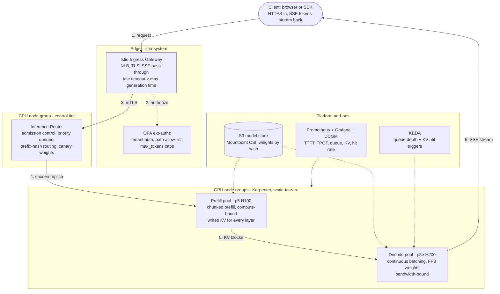

# Architecture

One EKS cluster, two tiers: a **CPU control tier** that handles everything that is not a forward pass, and a **GPU data tier** that does nothing but forward passes. A request flows **edge → router → prefill pool → decode pool**, and the SSE token stream flows back the same path.

## Why the GPU tier is split

Prefill and decode are different workloads wearing the same model:

| | Prefill | Decode |
|---|---|---|
| Shape | One matmul over all N prompt tokens | One matvec per token |
| Bound by | FLOPs (compute) | HBM bandwidth (memory) |
| Bursty? | Yes - a 100K prompt is one huge step | No - steady per-token cadence |
| Right GPU | H100/B200 (FLOPs per dollar) | H200 (KV capacity + bandwidth) |

Co-locating them makes decode inter-token latency jitter every time a prefill lands, and forces one batch policy onto two different workloads. Separate pools let each be sized and tuned alone; after prefill, the KV blocks for the prompt are pushed to the chosen decode replica (NVLink same-node, EFA/RDMA across nodes, or a shared DRAM/NVMe tier via LMCache/NIXL).

**When disaggregation pays off:** long or bimodal prompt lengths, tight ITL SLOs, and enough GPUs that pool-level specialization beats a single pool's flexibility. For small deployments, run one combined pool and keep the router.

## Layer map

| Layer | On EKS | What it does | Terraform |
|---|---|---|---|
| Edge | Istio ingress gateway on NLB | TLS, SSE pass-through, long idle timeouts | `modules/istio` |
| Policy | OPA ext-authz at the gateway | Tenant auth, path allow-list, max_tokens caps | `modules/opa`, `policies/` |
| Router | CPU Deployment (vLLM production-stack router) | Admission control, priority queues, prefix-aware routing | `modules/vllm` |
| Prefill pool | vLLM prefill pods on p5 (H100) | Chunked prefill, long-prompt isolation | `modules/vllm` |
| Decode pool | vLLM decode pods on p5e (H200), FP8 | Continuous batching, ITL tuning | `modules/vllm` |
| Model store | S3 + Mountpoint CSI, NVMe cache | Fast cold starts, weights pinned by hash | `modules/s3` |
| Autoscaling | KEDA on queue depth + KV util; Karpenter for nodes | Scale under slow cold starts, scale-to-zero when idle | `modules/keda`, `modules/karpenter` |
| Observability | Prometheus, DCGM, Grafana | TTFT, TPOT, queue depth, KV util, hit rate | `modules/observability` |
| Mesh | Istio strict mTLS + AuthorizationPolicies | Zero-trust between every tier | `modules/istio` |

## Request lifecycle

1. **Edge** - TLS termination, SSE stream setup. The NLB idle timeout is raised above the max generation time so a long completion is never cut mid-stream.
2. **OPA** - the gateway consults OPA (Envoy ext-authz gRPC) before routing: is the API key a known tenant, is the path allowed, is `max_tokens` within the tenant's cap? Rejections cost zero GPU-seconds.
3. **Router** - admission check (is there KV room?), priority queue, replica selection by prefix hash so a multi-turn conversation lands on the replica already holding its KV.
4. **Prefill** - one forward pass over all prompt tokens, chunked (`--enable-chunked-prefill`, bounded `max-num-batched-tokens`) so one long prompt never stalls the step.
5. **First token** - sampled, detokenized, flushed as the first SSE chunk. TTFT = queue wait + prefill; everything after is decode.
6. **Decode loop** - one token per step, continuous batching, until EOS / `max_tokens` / stop string. Disconnect detection aborts the request so a dead client never holds GPU memory.

## Autoscaling under slow cold starts

A GPU cold start is node provisioning (2-5 min) + image pull + weight load + CUDA graph capture - **5-15 minutes if you do nothing**. The design compensates at every layer:

- **Scale on inference signals, never CPU**: KEDA triggers on `vllm:num_requests_waiting` and `vllm:gpu_cache_usage_perc`. Scale out early on the arrival slope, scale in slowly (20-min cooldown) to avoid flapping.
- **Shrink the cold start**: Bottlerocket nodes carry a 1 TB NVMe data volume; Mountpoint S3 CSI caches weight blocks locally; the S3 gateway endpoint keeps the pull off the NAT.
- **Scale to zero**: `decode_min_replicas = 0` + Karpenter `WhenEmptyOrUnderutilized` consolidation means an idle cluster runs only the two CPU control nodes.
- **Protect while scaling**: the router's admission control sheds or queues low-priority work while new replicas come up - autoscaling is never the only defence against a burst.

## Cost model

Cost per million tokens = GPU dollars per hour ÷ tokens per hour actually served. The two levers that matter are **utilization** and **bytes per token**; everything else is a 10-30% trim. This architecture bakes in the big ones: FP8 weights + FP8 KV (≈1.5-2×), prefix caching (30-80% of prefill), scale-to-zero + consolidation (utilization), and per-phase GPU right-sizing. See the [cheat sheet](cheat-sheet.md#24-25-cost-and-capacity-planning) for the full capacity-planning walkthrough.
