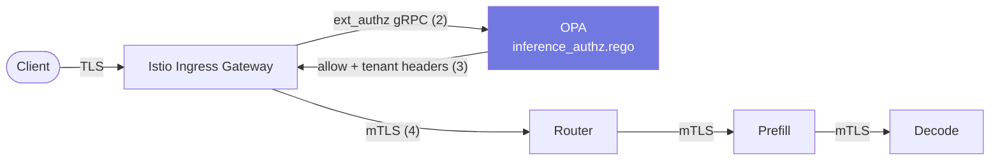

# Zero-Trust: Istio + OPA

The GPU tier serves expensive, multi-tenant, often-sensitive traffic. Two controls wrap it:

1. **Istio** - *who can talk to whom*: strict mTLS workload identity between every tier.
2. **OPA** - *what they are allowed to ask*: request-level policy at the gateway, decided before a single GPU cycle is spent.

## Istio layer

| Control | Resource | Effect |
|---|---|---|
| Strict mTLS mesh-wide | `PeerAuthentication` (istio-system) | A pod without a valid SPIFFE identity cannot open a connection to any tier |
| Default deny | Empty `AuthorizationPolicy` in `inference` | Nothing talks to anything unless explicitly allowed |
| Gateway → router only | `allow-gateway-to-router` | Only the ingress gateway's service account may call the router, only on `/v1/*`, `/health`, `/metrics` |
| Router → engines only | `allow-router-to-engines` | GPU pods accept traffic from the router SA, plus prefill → decode for KV transfer. Nothing else - not even other pods in the namespace |
| SSE-safe edge | NLB `idle_timeout=4000s`, VirtualService `timeout: 3600s`, `retries: 0` | Long generations are never cut mid-stream, and a generation request is never blindly replayed |

The legal request path is therefore exactly: **gateway → router → prefill/decode**, each hop authenticated by workload identity, not network position. A compromised pod elsewhere in the cluster cannot reach the engines.

## OPA layer

Istio registers OPA as an **extension provider** (`envoyExtAuthzGrpc`), and a `CUSTOM` AuthorizationPolicy on the gateway sends every `/v1/*` request to OPA before routing. The policy ([`policies/inference_authz.rego`](../policies/inference_authz.rego)) implements the multi-tenant admission rules from the cheat sheet (problem 21):

- **Tenant authentication** - the `Authorization: Bearer` key must map to a known tenant; unknown keys are rejected with a reason, at the edge.
- **Path allow-list** - only the OpenAI-compatible endpoints (`/v1/chat/completions`, `/v1/completions`, `/v1/embeddings`, `/v1/models`) are reachable. Admin and debug surfaces don't exist externally.
- **max_tokens caps per tenant tier** - a request whose `max_tokens` exceeds the tenant's cap is refused **before it can occupy KV memory**. Estimating request cost before admission is the cheapest form of GPU capacity protection.
- **Tenant header injection** - allowed requests gain `x-tenant` / `x-tenant-tier` headers so the router can do weighted fair queuing per tenant and Prometheus can slice every metric by tenant.

### Why OPA at the edge instead of logic in the router?

- A rejection at the gateway costs microseconds of CPU; a rejection at the router costs a mesh hop; a rejection at the engine costs scheduler work and possibly KV allocation.
- Policy as data: tenant budgets ship as an OPA bundle/ConfigMap and change without redeploying the serving path.
- One decision log: every allow/deny is logged centrally with the full input, which is your audit trail for who asked what of which model.

### Production notes

- The in-repo tenant table is a **demo stub** - ship real tenant records via [OPA bundles](https://www.openpolicyagent.org/docs/latest/management-bundles/) from S3, keyed by *hashed* API keys.
- Rate limiting (tokens per minute) needs counters: pair OPA's static budgets with Envoy global rate limiting or the router's own token-bucket per tenant. OPA decides *policy*; counting belongs in a stateful component.
- OPA runs 2 replicas on the control tier with mesh sidecars - the policy decision path itself is mTLS-protected and horizontally scalable.
